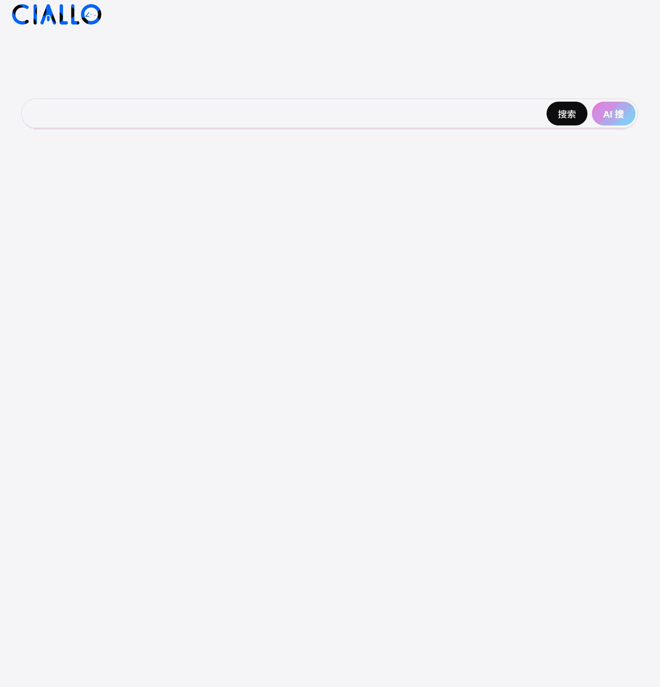
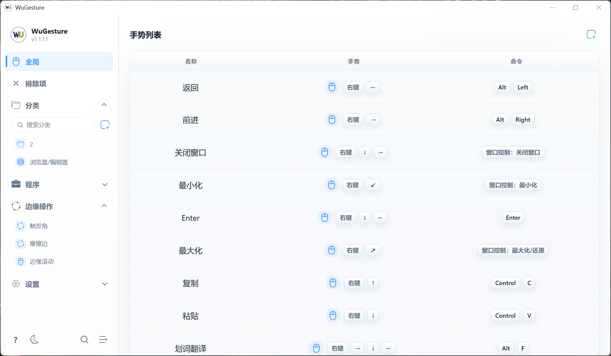
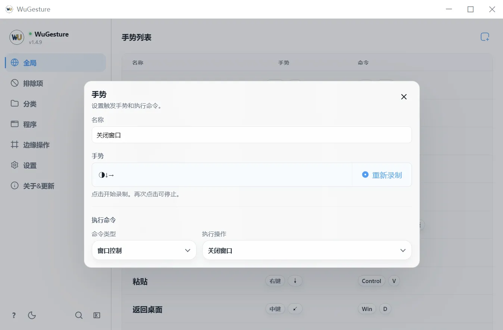
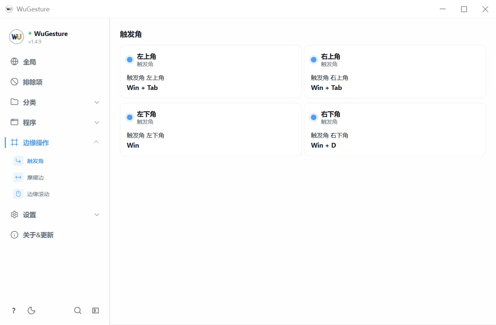
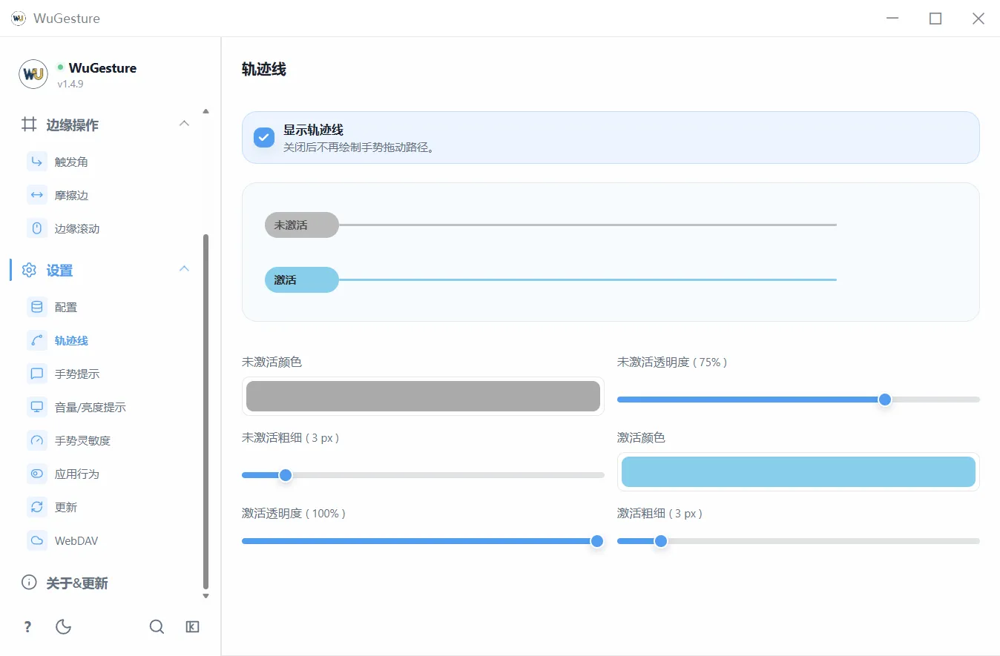

<div align="center">

# WuGesture

**Windows 鼠标手势工具** —— 按住右键或中键划一笔，就能执行快捷键、控制窗口、调节音量亮度，或者触发屏幕边缘的快捷操作。

[](https://github.com/illlustionary/WuGesture/releases)
[](https://github.com/illlustionary/WuGesture/actions)


</div>

<p align="center"></p>

手势轨迹实时跟随鼠标，匹配到规则后会在鼠标所在屏幕底部显示命中的动作名；轨迹和提示绘制在透明覆盖层上，鼠标穿透、不抢焦点，底层应用照常操作。

<p align="center"></p>

## 目录

- [功能特性](#功能特性)
- [界面导览](#界面导览)
- [下载与安装](#下载与安装)
- [快速上手](#快速上手)
- [数据与配置文件](#数据与配置文件)
- [常见问题](#常见问题)
- [从源码构建](#从源码构建)
- [项目结构](#项目结构)
- [开发文档](#开发文档)
- [持续集成与发行](#持续集成与发行)
- [致谢](#致谢)

## 功能特性

### 手势与规则

- **右键 / 中键手势**：8 方向识别，支持多笔画组合，单次手势最多 12 段。
- **方向 + 滚轮修饰**：按住右键或中键先绘制方向手势，再继续按住滚动滚轮，即可把滚轮上/下作为修饰符匹配另一套规则；方向留空时也能按住直接滚动。每条滚轮规则可选择「每格连续执行」或「松开时执行一次」，适合连续调节音量、亮度或只触发一次的动作。滚轮使用后会吞掉点击重放，未配置滚轮修饰的按键仍保持正常滚动。
- **三级作用域**：全局规则、分类规则、程序规则各自独立；同一手势冲突时按「程序 → 分类（按应用的分类顺序）→ 全局」优先。
- **不会误吞单击**：位移不足、未构成手势时，会把原本的右键/中键单击重放给目标窗口，右键菜单正常工作。
- **目标窗口可选**：动作作用于「手势起始窗口」或「当前窗口」，适配切换焦点式的用法。
- **灵敏度可调**：0–200% 连续滑块，越高越容易识别出方向与转角，中等值适合大多数鼠标。

<p align="center"></p>

在规则列表里点手势按钮就能打开上面的弹窗，重新录制方向手势、改名称、选择滚轮修饰与触发方式，或者切换命令类型与具体操作。

### 动作类型

| 类型 | 可用动作 |
| --- | --- |
| 快捷键 | 任意组合键（Ctrl / Alt / Shift / Win），支持功能键与字母数字键 |
| 窗口控制 | 置顶 / 取消置顶、最大化 / 还原、最小化、关闭窗口 |
| 音量控制 | 音量 +、音量 −、静音 |
| 亮度控制 | 亮度 +、亮度 − |
| 运行程序 | 以配置的参数启动指定程序 |

窗口控制只会作用于真正的应用窗口，桌面、任务栏、任务视图、Alt+Tab、开始菜单、搜索等 Shell 界面会被跳过，避免把桌面或 Shell 最小化。

### 边缘操作

手势之外，屏幕边缘也可以直接触发动作，每个位置都能单独绑定动作与参数：

- **触发角**：屏幕四角，鼠标移入角落后触发一次，离开再进入可再次触发。
- **摩擦边**：屏幕四条边，贴着边缘来回摩擦指定次数（默认 4 次）后触发，离开边缘后复位。
- **边缘滚动**：光标停在屏幕边缘滚动滚轮时触发（例如切歌、切标签页）。

边缘操作与手势规则互相独立，也可以在排除项里对单个程序关闭边缘操作。

<p align="center"></p>

四个角、四条边和每个滚动方向都能单独绑定命令，上图即为四角各自绑定快捷键的配置。

### 可视化反馈

- **轨迹线**：可分别设置「未匹配」与「已匹配」两套颜色、粗细和不透明度。
- **手势提示**：命中规则后显示动作名，可配置字体、字号、文字/背景色、透明度、宽度、高度、圆角、底部偏移，以及停留与淡出时长；宽度可自适应文字。
- **音量 / 亮度提示**：调节时显示带图标和轨道的 OSD，支持居中、顶部居中、底部居中、四角共 7 种位置预设，尺寸、圆角、配色、偏移和淡出都可调。
- 三者复用同一个全虚拟桌面透明分层窗口，各自独立生命周期与透明度，互不干扰。

### 应用行为

| 选项 | 说明 |
| --- | --- |
| 开机自启动 | 默认关闭；开启后随系统后台启动，不弹出配置窗口 |
| 启动时显示配置窗口 | 关闭后以后台方式驻留托盘，可从托盘打开 |
| 以管理员身份打开 | 保存后下次启动生效；在 UAC 中拒绝会直接退出，不会降级运行 |
| 全屏时禁用手势 / 边缘操作 | 两个开关独立，适合全屏游戏与播放器 |
| 在桌面禁用鼠标手势 | 在桌面空白处和图标上不响应手势，其他窗口不受影响 |
| 关闭按钮 | 最小化到托盘（默认）、最小化到任务栏、直接关闭 |
| 目标窗口 | 起始窗口（默认）或当前窗口 |

托盘菜单提供「打开配置」「暂停 / 恢复手势」「退出」；双击托盘图标只做置顶激活，不会重建配置窗口。

### 配置与同步

- **本地备份**：在「设置 > 配置」里导出/导入 JSON，导入前会再次确认覆盖；恢复默认会重置轨迹线、提示窗、应用行为、排除项、WebDAV 和更新设置，不动手势规则、分类、程序和边缘操作。
- **WebDAV 同步**：测试连接成功后，可把当前配置保存到远端或从远端恢复。
- **自动更新**：默认以 Gitee 为更新源（失败时自动回退 GitHub）；下载完成后校验发行说明里的 SHA256，退出后由脚本替换文件并重启。
- **单实例**：重复启动只会唤醒已运行实例的配置窗口；`WuGesture.exe --exit` 可在不新建窗口的情况下请求退出。

## 界面导览

左侧是规则与设置的导航，右侧是编辑区：

| 分组 | 页面 | 用途 |
| --- | --- | --- |
| 规则 | 全局 | 所有应用通用的默认手势 |
| 规则 | 分类 / 程序 | 按分类或具体进程覆盖规则、维护归属关系 |
| 边缘 | 触发角 / 摩擦边 / 边缘滚动 | 屏幕边缘的快捷操作 |
| — | 排除项 | 不响应手势的程序，可单独关闭其边缘操作 |
| 设置 | 配置 | 导出、导入、恢复默认 |
| 设置 | 轨迹线 / 手势提示 / 音量亮度提示 | 视觉反馈，页面顶部带实时预览 |
| 设置 | 手势灵敏度 / 应用行为 | 识别参数、启动方式、全屏行为 |
| 设置 | 侧栏 | 侧栏收起后的唤醒距离 |
| 设置 | 更新 / WebDAV | 更新源与备份 |
| — | 关于 & 更新 | 版本、发行说明、检查更新 |

规则页支持录制手势与快捷键、应用选择器与窗口拾取、程序列表拖拽排序，以及通过侧栏底部对话框调整规则生效顺序；侧栏底部还提供主题切换和快速搜索。

<p align="center"></p>

轨迹线、手势提示、音量/亮度提示三个页面都是「顶部实时预览 + 下方参数」，拖动滑块时能直接看到改动效果。

## 下载与安装

### 系统要求

| 项目 | 要求 |
| --- | --- |
| 系统 | Windows 10 / 11 x64 |
| 运行时 | [.NET 10 Desktop Runtime x64](https://dotnet.microsoft.com/download/dotnet/10.0/runtime)（必需，发行包为 framework-dependent） |
| 浏览器组件 | [WebView2 Runtime](https://developer.microsoft.com/microsoft-edge/webview2/)（Win11 通常已自带；缺失时应用会给出下载引导） |

### 安装

1. 从 [GitHub Releases](https://github.com/illlustionary/WuGesture/releases) 或 [Gitee 镜像](https://gitee.com/neko_nya/WuGesture/releases) 下载 `WuGesture-v<版本>-windows-x64.zip`；
2. **完整解压**到任意目录（不要直接在压缩包里运行）；
3. 运行根目录的 `WuGesture.exe`。

覆盖升级时退出应用后直接替换整个目录即可；也可以让应用内更新自动完成。卸载时删除程序目录，再按需清理下面列出的用户数据目录。

## 快速上手

1. 首次启动会打开配置窗口，默认已带一套全局手势，可直接按住右键划动试用。
2. 在「全局」页点击新增规则，选择鼠标键（右键 / 中键），录制手势方向或切到「滚轮手势」选择滚轮方向，再选择动作（快捷键、窗口控制、音量亮度或运行程序）。
3. 想让某些手势只在特定程序里生效，就在「程序」页添加该程序并新建规则；也可以先建分类，再把多个程序归入分类。
4. 手势轨迹不显示或误触发时，到「设置 > 手势灵敏度」调整，或在「设置 > 轨迹线 / 手势提示」里改视觉反馈。
5. 把配置导出或同步到 WebDAV，换机器时导入即可。

## 数据与配置文件

| 路径 | 内容 |
| --- | --- |
| `%AppData%\WuGesture\gestures.json` | 主配置：手势规则、分类、程序、边缘操作、界面与行为设置、WebDAV 与更新设置 |
| `%AppData%\WuGesture\window-state.json` | 配置窗口的位置与大小（不参与导出/导入） |
| `%AppData%\WuGesture\gestures.backup-<时间戳>.json` | 原子替换失败时保留的上一份配置 |
| `%LocalAppData%\WuGesture\WebView2` | WebView2 浏览器配置目录 |
| `%LocalAppData%\WuGesture\logs` | 应用日志（排查启动、更新、覆盖层问题） |
| `%LocalAppData%\WuGesture\updates` | 自动更新下载的安装包与临时文件 |

主配置写入采用「临时文件 + 原子替换」，断电或崩溃不会留下被截断的 `gestures.json`。

## 常见问题

<details>
<summary>全屏游戏里看不到轨迹和提示，但手势仍然生效</summary>

手势识别走的是系统全局低级鼠标钩子，和绘制层完全独立，所以「功能正常、画面不可见」是预期现象。看不到绘制通常有两种原因：

- **独占全屏 / 独立翻转**：游戏直接接管显示输出，DWM 合成被旁路，任何分层窗口都无法叠加。这类情况属于系统限制，只能让游戏改用无边框全屏。
- **TopMost 层级顺序**：覆盖层只在创建时置顶，且从不激活，因此在置顶层里不会自行上浮。v1.4.9 起会在每笔手势开始时重新把它插到最顶层，晚于覆盖层启动的置顶窗口不会再长期压住它。

</details>

<details>
<summary>某个程序里手势没反应</summary>

先检查它是否在「排除项」里，以及是否开启了「全屏时禁用手势」。以管理员身份运行的程序如果 WuGesture 是普通权限，系统会限制跨权限级别的输入注入，可在「应用行为」里开启「以管理员身份打开」后重启。

</details>

<details>
<summary>更新完某个程序后立刻打开，它压住了手势轨迹</summary>

这就是上面第二种情况，已在 v1.4.9 修复；升级后无需再重启 WuGesture。

</details>

<details>
<summary>怎么备份 / 换电脑迁移</summary>

「设置 > 配置」导出 JSON，新机器上导入即可。导出不含窗口位置和大小。也可以配置 WebDAV 后在两台机器间同步。

</details>

<details>
<summary>提示缺少 .NET 或 WebView2</summary>

按提示安装 [.NET 10 Desktop Runtime x64](https://dotnet.microsoft.com/download/dotnet/10.0/runtime) 或 [WebView2 Runtime](https://developer.microsoft.com/microsoft-edge/webview2/) 后重新启动。发行包不内置 .NET 运行时。

</details>

<details>
<summary>怎么彻底退出</summary>

托盘菜单「退出」，或在命令行执行 `WuGesture.exe --exit`。关闭按钮的默认行为是最小化到托盘，可在「设置 > 应用行为」改为直接关闭。

</details>

## 从源码构建

### 环境

- Windows 10/11 x64
- .NET 10 SDK
- Node.js 22 + pnpm（`corepack enable` 即可）
- 桌面端：C# / WinForms / WebView2；前端：Vue 3 + Vite

首次准备前端依赖：

```powershell
cd src\WuGesture.App\Web
pnpm install
```

### 运行

```powershell
dotnet run --project src\WuGesture.App\WuGesture.App.csproj
```

前端源码改动后，桌面工程会在构建时自动执行 `vite build`，无需单独启动 dev server；只调界面时也可以在 `src\WuGesture.App\Web` 下运行 `pnpm dev`，浏览器里以预览模式打开。

### 构建

```powershell
dotnet build WuGesture.slnx
```

如果只安装了 .NET 运行时、SDK 装在用户目录（例如用 `dotnet-install.ps1` 装到 `%USERPROFILE%\.dotnet`），系统 `dotnet` 命令不会自动发现它，直接指定该 SDK 的可执行文件：

```powershell
%USERPROFILE%\.dotnet\dotnet.exe build WuGesture.slnx
```

### 测试与格式

```powershell
dotnet test WuGesture.slnx
dotnet format WuGesture.slnx --verify-no-changes

cd src\WuGesture.App\Web
pnpm test
pnpm format:check
```

### 打包

```powershell
.\scripts\package-debug.ps1                                  # 调试包，不需要版本号
.\scripts\publish-app.ps1                                    # 通用发布到 artifacts\publish
.\scripts\package-release.ps1 -Version v1.4.9                # 发行包 + RELEASE_NOTES.md
```

打包脚本会关闭正在运行的 WuGesture、按版本发布，并调用 `scripts\verify-package.ps1` 校验必需文件、哈希资源与文件版本。

## 项目结构

```text
WuGesture/
├─ src/WuGesture.App/            桌面宿主（WinForms + WebView2）
│  ├─ Application/               生命周期、托盘、提权重启、WebView 消息、配置协调
│  ├─ GestureEngine/             全局鼠标钩子、手势识别、规则匹配、动作执行、边缘操作
│  ├─ Overlay/                   透明分层覆盖层与轨迹线、提示、OSD 渲染
│  ├─ Configuration/             配置模型、默认值、原子存储与迁移
│  ├─ Updater/                   自动更新检查、下载与安装
│  ├─ Resources/                 图标等嵌入资源
│  └─ Web/                       Vue 3 + Vite 配置界面
├─ tests/WuGesture.App.Tests/    .NET 单元测试
├─ scripts/                      发布、打包、覆盖率校验脚本
├─ docs/                         架构与发行文档、截图
└─ .github/workflows/            CI、共享测试与发行流水线
```

## 开发文档

- [架构说明](docs/architecture.md)：启动流程、手势流水线、性能约束、更新与 WebView2 集成。
- [发行维护](docs/releasing.md)：打包脚本、发行门禁、标签与回滚流程。
- [桌面端项目结构](PROJECT_STRUCTURE.md)：宿主模块职责、配置契约、消息协议。
- [前端项目结构](src/WuGesture.App/Web/PROJECT_STRUCTURE.md)：页面、路由、状态与组件细节。

## 持续集成与发行

| 工作流 | 触发 | 内容 |
| --- | --- | --- |
| `ci.yml` | 推送到 `main` / PR | Prettier 检查、前端 Vitest、`dotnet build -warnaserror`、`dotnet format --verify-no-changes`、带覆盖率的测试与覆盖率下限校验 |
| `test.yml` | 被其他工作流复用 | 同一套测试门禁 |
| `release.yml` | 推送 `v*` 标签 | 先跑测试，再打包、创建 GitHub Release，并把代码与标签镜像到 Gitee、创建 Gitee Release |

发行步骤：确认 `main` 通过 CI 后打标签并推送。

```powershell
git tag -a v1.4.9 -m "WuGesture v1.4.9"
git push origin v1.4.9
```

发行说明由相邻标签之间的提交自动生成，ZIP 的 SHA256 会写进说明末尾；测试不通过时不会产生任何发行版。依赖更新由 `.github/dependabot.yml` 每周分组提交。

## 贡献

欢迎提交 Issue 和 PR。提交前请确保：

- `dotnet build WuGesture.slnx` 无警告；
- `dotnet test WuGesture.slnx` 与 `pnpm test` 全部通过；
- `dotnet format WuGesture.slnx --verify-no-changes` 和 `pnpm format:check` 无差异；
- 涉及结构、启动流程、配置、构建发布、WebView 消息或核心模块职责的改动，同步更新对应的 `PROJECT_STRUCTURE.md`。

## 致谢

- 界面图标基于 [Lucide](https://lucide.dev/)（ISC License）。
- 部分代码与实现思路参考了 [yingDev/WGestures](https://github.com/yingDev/WGestures)。
- 配置界面使用 [Vue 3](https://vuejs.org/)、[Vite](https://vite.dev/) 与 [UnoCSS](https://unocss.dev/)。
- 桌面宿主基于 WinForms 与 [WebView2](https://developer.microsoft.com/microsoft-edge/webview2/)。
